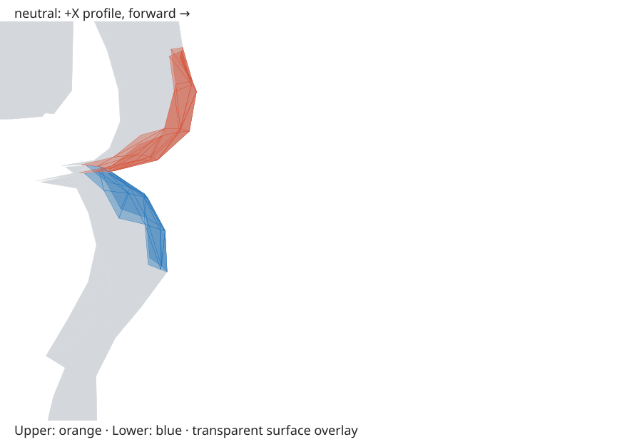
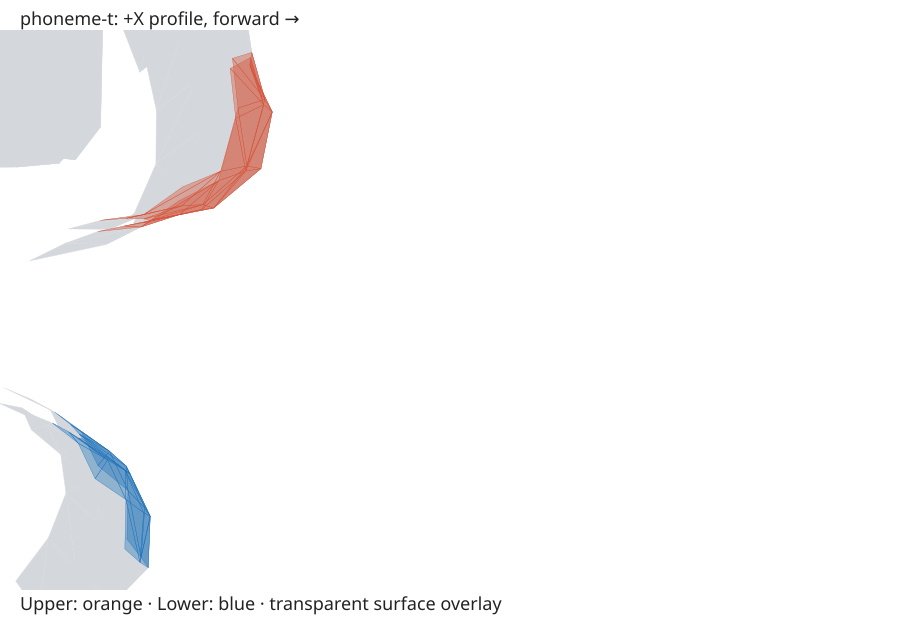

# Neutral and pre-tuning T: FaceCap profile measurements

This is the archived issue #147 baseline (T jawOpen 0.28). The library now uses
the search result documented in [T tuning](t-lip-tuning.md). These original
measurements and images remain unchanged so later work can compare against them.

**Neutral already has an upper-lip overhang.** In the selected lip surfaces,
neutral's upper lip extends 26.576 mm farther forward than the lower lip.
Their side projections overlap, but the actual 3D surfaces do not intersect.
The pre-tuning T also has no 3D intersection. It removes the projected overlap and
increases surface clearance, while increasing forward overhang to 78.649 mm
(52.073 mm more than neutral). Forward overhang and surface clearance describe
different properties; neither alone establishes penetration.

Later T issues should judge improvement relative to this neutral baseline,
rather than requiring complete separation solely because neutral looks occluded
in profile. The pre-tuning T improves clearance and projected visibility, but does
not improve the forward-extent measure.

## Profile images

Both images are orthographic +X views of the real default FaceCap mesh with an
identical mouth crop and scale. Forward (+Z) is right. Gray is mesh context;
orange upper and blue lower lip triangles are transparent overlays, allowing
occluded surfaces to remain inspectable. These are geometry-derived SVG profile
captures, not screenshots of the application's shaded material or physics frames.
The overlay intentionally draws both sides of the mouth; its opacity is not a
visibility/occlusion measurement. The 2D projected-triangle calculation supplies
that separate result.





## Measurements

All lengths below use the GLB's authored world coordinates, interpreted as metres
per glTF, converted to millimetres. No viewport normalization or assumed human
head dimensions are applied. These are asset-space physical lengths, not a
calibrated measurement of an actual person's anatomy. In particular, the large
T opening is the result of the current morph weights and authored source scale;
it has not been rescaled to look anatomically typical.

| Region | Neutral minimum gap (mm) | T minimum gap (mm) | Neutral forward overhang (mm) | T forward overhang (mm) |
| --- | ---: | ---: | ---: | ---: |
| Front (central third) | 1.394 | 143.206 | 26.576 | 78.649 |
| Middle, negative X | 1.126 | 134.218 | 27.278 | 77.242 |
| Middle, positive X | 1.126 | 132.543 | 28.436 | 79.742 |
| Corner-adjacent, negative X | 1.246 | 127.026 | 23.995 | 72.646 |
| Corner-adjacent, positive X | 1.280 | 127.026 | 26.778 | 78.916 |
| Entire selected surfaces | 1.126 | 127.026 | 26.576 | 78.649 |

Middle minimum across both sides: neutral 1.126 mm, T 132.543 mm.
Corner-adjacent minimum across both sides: neutral 1.246 mm, T 127.026 mm.
There is no detected 3D intersection in either pose, globally or regionally.
Neutral side projections overlap globally, in the front and negative-X middle;
the remaining regional projections do not overlap. None of T's projections
overlap. Thus neutral's overlap is a side-view hiding effect, not penetration of
the measured upper/lower surfaces. T retains forward overhang without projected
surface overlap.

## Reproducible method and limits

The original attachment manifest is empty. The source is the application's real
default `https://threejs.org/examples/models/gltf/facecap.glb`, SHA-256
`6bfce6d0fcbb5839f5102b79733007859fef7c5df6d9eb49e2264542810b5f64`.
The shared loader rejects changed source bytes. It uses GLTFLoader and
MeshoptDecoder, removes materials only, and decodes the original quantized
accessors. `computePosedSurfacePositions`, also used by the lip-gap check and
physics pose targets, applies the current library weights with the provider's
alias resolution and clamping. Neutral has zero weights. T uses jawOpen 0.28,
mouthUpperUpLeft/Right 0.10 and mouthLowerDownLeft/Right 0.06. No pose weights or
application behavior were changed for this measurement.

The neutral-bound selection in `e2e/facecap-lip-regions.ts` contains 40 upper and
32 lower triangle ordinals, including the outer rolls. Front/middle/corner here
mean lateral bands, not depth bands: distance from the selection's neutral X
midpoint is split into thirds of its half-width. Negative and positive X are
kept separate before taking the smaller gap. Exact slab boundaries in world
metres are stored in [measurements.json](lip-profile/measurements.json). They
remain fixed between poses. Triangles are clipped to those slabs rather than
assigned by centroid. Global results compare every selected upper/lower pair,
including across regional boundaries.

**Corner limitation:** the inherited selection excludes the shared commissures.
The corner rows measure the outer third of this selected strip, immediately
adjacent to the corners; they do not claim clearance at the shared attachment
itself or rule out intersections elsewhere on the head. No original anatomical
annotation identifying a separate pair of commissure surfaces was supplied.
The shared junction cannot be treated as two independently separated surfaces
without defining an additional anatomical selection.

The minimum gap is unsigned Euclidean triangle-to-triangle distance, using
vertex/face and edge/edge candidates. The existing separating-axis calculation
checks actual 3D intersections (contact counts as intersection with a 1e-12 m
roundoff guard). Forward overhang is `max(upper Z) - max(lower Z)`, computed
within each band; it is an extent difference, not penetration depth or a paired
landmark displacement. Side overlap is an intersection of triangles projected
onto YZ, independently of their X separation. Degenerate projected triangles
are excluded. No positive clearance threshold is imposed by this measurement
issue.

## Capture and deferred checks

The measurement/data-capture helper was executed to create these artifacts;
no build, test suite, or separate validation run was performed. Publisher checks
remain pending. To reproduce the data capture, start `npm run dev` and then run:

```sh
node e2e/capture-lip-profiles.mjs --archived
```

The `--archived` option replays the weights recorded in the existing report;
omitting it captures the current library T instead. The capture writes only requested artifacts beneath `docs/lip-profile/`, with
SHA-256 byte hashes for the two SVGs and complete JSON report in `integrity.json`.
It never copies the original-files directory. There is no content normalization:
hashes cover the exact UTF-8 output bytes including trailing newlines.

Deferred reproducible checks:

```sh
node --test scripts/lip-profile-integrity.test.mjs
npx playwright test e2e/lip-profile.spec.ts
```

The integrity test hashes all three artifacts and checks every region/side,
including the final corner record. The browser tests cover clipping, distinguish
projection overlap from 3D penetration, and compare a fresh real-mesh capture using the archived explicit T weights to
the complete committed measurements and both SVG image strings. Source changes,
pose changes, omitted records, or changed image content require explicit review
and a new capture; a missing asset fails instead of skipping.
