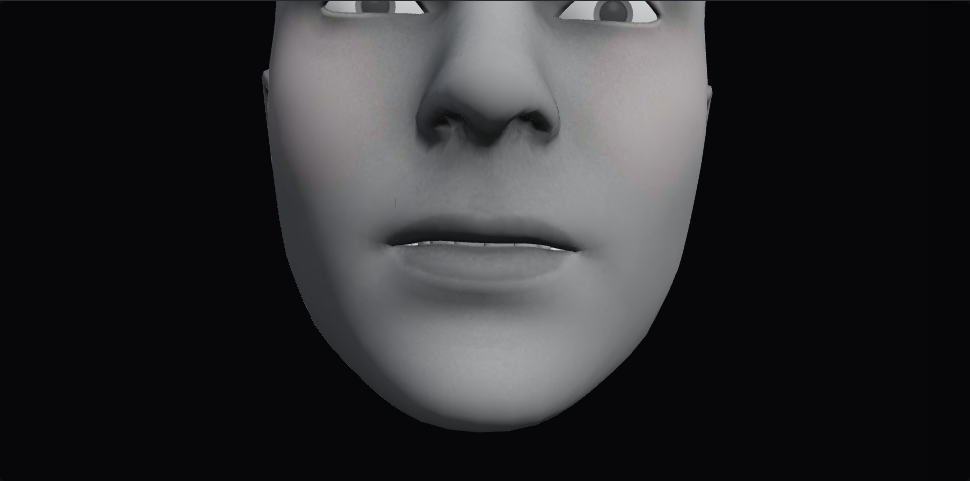
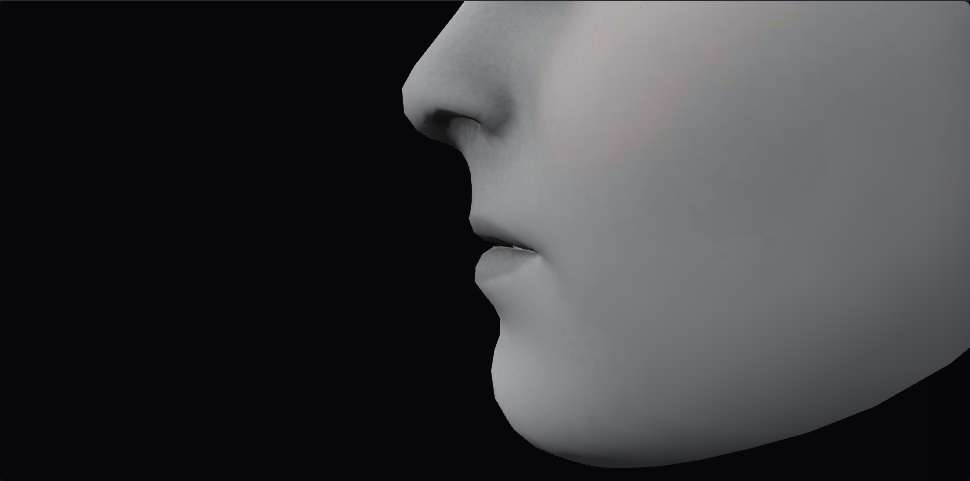

# Lip overlap regression gates

Issue #149 replaces the exact T-weight unit lock with intent checks and adds
strict real-surface and visual regression gates. The original-files manifest is
empty. All mesh measurements use the real default FaceCap GLB pinned to SHA-256
`6bfce6d0fcbb5839f5102b79733007859fef7c5df6d9eb49e2264542810b5f64`.

The implementation's measurement captures cover **all 25 named presets and all
8 binary mouth/jaw AU slider endpoints**, including the last combination
`slider-7`. The final captured matrix has no intersections, insufficient required
clearance, or excess neutral-relative overhang. These are data-capture results,
not a claim that the test suite passed. No build, test suite, or separate
self-audit was run, following the implementation-only workflow. The requested
full lip-suite execution remains deferred to publisher validation.

## Automatic gates

- The pose audit requires T to omit mouthClose, lip-press controls and funnel,
  with jawOpen in the search's 0–0.12 range. It no longer freezes its exact
  upper/lower/roll weights. The separate real-mesh selection regression retains
  the reviewed #148 evidence and checks actual geometry.
- Every preset and slider endpoint gets a 3D triangle intersection test and a
  forward-extent comparison against neutral. Positive overhang is allowed only
  up to neutral's 26.576 mm. There is no extra penetration or overhang allowance.
- Every preset intended to part its lips, including T, requires a global minimum
  lip-surface distance of **2 mm**, raised from 0.1 mm. The global minimum also
  covers the selected corner-adjacent triangles; this is stronger than a single
  center sample. Contact poses have no positive-gap requirement but still must
  avoid lip/lip intersection and excess overhang.
- Slider clearance intent follows included AU 22/AU 25 controls, rather than a
  hard-coded jaw-weight threshold that retuning could silently bypass.
- Both existing T canvas captures now use `toHaveScreenshot` against committed
  Chromium/Linux references. Pixel color threshold is 0.15, with at most **100
  differing pixels**, not a broad percentage of the whole viewport. Missing
  references or mismatch fail. There are still diagnostic screenshot attachments.

The source-derived lip selection and world-metre interpretation are unchanged
from [#147](lip-profile.md). Shared commissures are excluded from that selection;
these tests do not claim collision coverage for unselected anatomy.

## Stored front and profile references





Reference capture and assertions use a fixed 1440×1100 browser viewport, device
scale factor 1, the real application materials/lighting, and a fixed mouth frame
based on neutral geometry. The camera is 1.35 display units from that target.
The helper waits for the actual T weights to settle, freezes the frame loop,
and explicitly renders each camera so orbit controls cannot re-aim it between
capture and assertion. Physics stays off. Only viewport DOM overlays are hidden
during screenshots; the entire rendered canvas, including the mouth, is compared.
This is a tighter mouth frame than the old whole-head evidence captures.

The reference files have byte hashes, alongside capture metadata, under the same
snapshot directory. Regeneration is an explicit script, not an automatic step
in the test command. A changed GPU/browser may require reviewing rasterization
differences; do not accept an overlapping-mouth image merely to update a baseline.

## Search-derived preset repairs

The stricter measurement exposed 15 failing named presets and failures in slider
combinations. The same `scripts/t-lip-search-browser.ts` search/measurement kernel
now also repairs these presets. It preserves non-search expressive controls,
tries original jaw activation first, and searches upper roll, lower-down, then
upper/lower combinations. When necessary it tries jaw fractions 0.75, 0.5 and
0.25 and jaw values 0.02, 0.04, 0.08, 0.12, 0.24 and 0.4. The lowest squared
weight change wins within the first feasible search stage. Unlike T, other
presets have no 12 mm maximum-opening filter: AA must remain an open vowel.

Upper-up candidates: original, 0, 0.08, 0.16, 0.32, 0.64, 1.
Lower-down candidates in the narrow stage: original, 0.005, 0.02, 0.08, 0.16,
0.32, 0.64, 1; the broad stage uses original, 0, 0.02, 0.08, 0.16, 0.32, 0.64, 1.
Upper-roll candidates: original, 0.05, 0.1, 0.2, 0.4, 0.7, 1. Duplicate values
are removed. Both sides receive the same upper/lower activation.

V exhausted the four T controls while retaining its existing closure. A recorded
contact-specific fallback searched closure fractions 0.75, 0.5, 0.25 and 0 while
retaining its lower-roll and funnel shapes. It selected mouthClose 0.045,
jawOpen 0.12 and mouthRollUpper 0.4, retaining mouthRollLower 0.55 and funnel 0.12.
V's 1.904 mm lip clearance is allowed because V is a contact-intent pose, as it
was before #149; it was not reclassified to evade the 2 mm gate.

Individually feasible AU repairs still produced excess overhang for AU 12 + AU
25. A joint search over each AU's 20 best feasible alternatives evaluated all
8 endpoint combinations per candidate tuple. The first passing tuple in summed
weight-change order was attempt 32. That selected AU 12 lower-down 0.32 per side
and upper-roll 0.2 while retaining its smile/dimple/cheek controls. No slider
case was removed and no threshold was relaxed.

Final search-controlled weights and measured global results follow. Upper/lower
columns are per-side weights; other expressive controls remain in the library.
The complete before/after weights, trials and decisions are linked below.

| Preset | jawOpen | upper-up | lower-down | upper-roll | Minimum gap (mm) | Overhang (mm) |
| --- | ---: | ---: | ---: | ---: | ---: | ---: |
| au-12-smile | 0 | 0 | 0.32 | 0.2 | 5.604 | 10.625 |
| au-22-lip-funneler | 0.08 | 0 | 0 | 0.05 | 101.128 | 24.146 |
| au-25-lips-part | 0.29 | 1 | 0 | 0.7 | 172.936 | 25.835 |
| expression-smile | 0 | 0 | 0.16 | 0 | 3.226 | 17.713 |
| expression-frown | 0.08 | 0 | 0 | 0.2 | 16.937 | 24.858 |
| expression-mouth | 0.19 | 0.34 | 0.38 | 1 | 95.016 | 21.607 |
| expression-cheek | 0 | 0 | 0.005 | 0 | 0.237 | 24.951 |
| expression-pucker | 0.12 | 0 | 0 | 0.05 | 109.928 | 25.158 |
| phoneme-n | 0.12 | 0.08 | 0.06 | 0.7 | 23.993 | 22.399 |
| phoneme-aa | 0.225 | 0 | 0.005 | 1 | 47.998 | 26.365 |
| phoneme-iy | 0.13 | 0.64 | 0 | 1 | 45.696 | 26.368 |
| phoneme-eh | 0.14 | 0.64 | 0 | 1 | 55.935 | 22.874 |
| phoneme-uw | 0.24 | 0 | 0 | 0.1 | 104.117 | 23.849 |
| phoneme-v | 0.12 | 0 | 0 | 0.4 | 1.904 | 25.411 |
| phoneme-y | 0.18 | 1 | 0 | 0.7 | 117.646 | 26.189 |

T is unchanged from search candidate 1130: minimum gap 9.888 mm, forward overhang
12.412 mm. AA's jaw activation is now 0.225, still 90 times T's 0.0025. Historical
#147/#148 data keep their original AA/T weights; archived profile reproduction
passes explicit archived weights rather than asserting that current poses equal
old poses. Smile alias/mapping unit expectations include the new lower-down
controls; N reference coverage now describes its actual parted-lip controls
rather than the obsolete pressed/funneled shape.

Evidence:

- [Before](lip-suite/before.json) and [final complete matrix](lip-suite/measurements.json).
- [Individual preset search trials](lip-suite/repairs.json). Its unresolved V
  result is followed by the explicit [contact fallback](lip-suite/contact-repairs.json).
- [Joint action/slider search](lip-suite/composition-repairs.json), including each
  tested endpoint and the final passing tuple.
- [Evidence byte hashes](lip-suite/integrity.json). There is no content
  normalization; hashes cover exact JSON/PNG bytes.

The integrity test checks every report row, required fields and source hash,
exact preset/slider counts, the final slider record, all search trial indices,
the final joint decision, and both reference hashes. No original attachments
were copied into application data or static paths.

## Reproduction and deferred full suite

With `npm run dev` running, capture measurements or explicitly regenerate the
references (reviewing them before acceptance):

```sh
node scripts/capture-lip-suite.mjs
node scripts/capture-t-lip-references.mjs
```

The repair search reads original weights directly from the stored before report
so later library changes do not rewrite the input history. To explore it without
replacing committed evidence:

```sh
LIP_REPAIRS_REPORT=/tmp/lip-repairs.json node scripts/search-lip-preset-repairs.mjs
LIP_REPAIRS_REPORT=/tmp/lip-contact.json node scripts/search-lip-preset-repairs.mjs phoneme-v
LIP_REPAIRS_REPORT=/tmp/lip-compositions.json node scripts/search-lip-preset-repairs.mjs --compositions
```

The search never edits library source automatically. Its candidates and all
failing measurements are retained for review. Searches that have no feasible
candidate report that fact rather than reducing the safety limits.

Publisher full lip-suite command:

```sh
npm run test:lip
```

This runs pose-audit intent tests, lip artifact integrity/policy tests, the
real-mesh all-preset/all-slider surface test, archived profile reproduction,
the selected-T measurement regression, and the real front/profile screenshot
assertions. It has **not** been run during implementation. Broader mandatory
build/audit/acceptance/live checks remain the deploy executor's responsibility.
