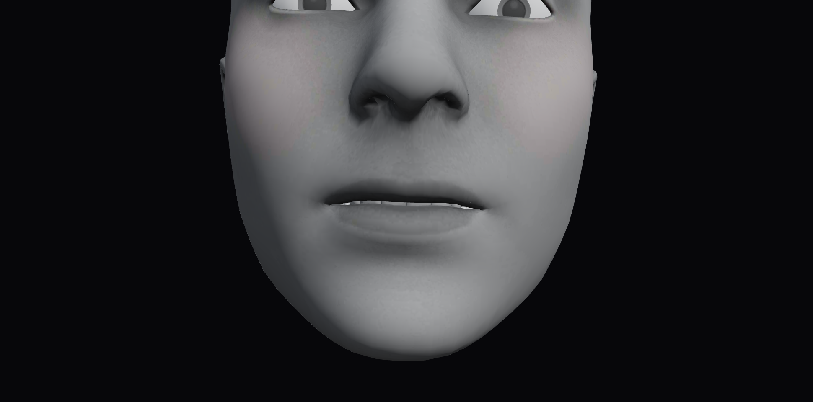
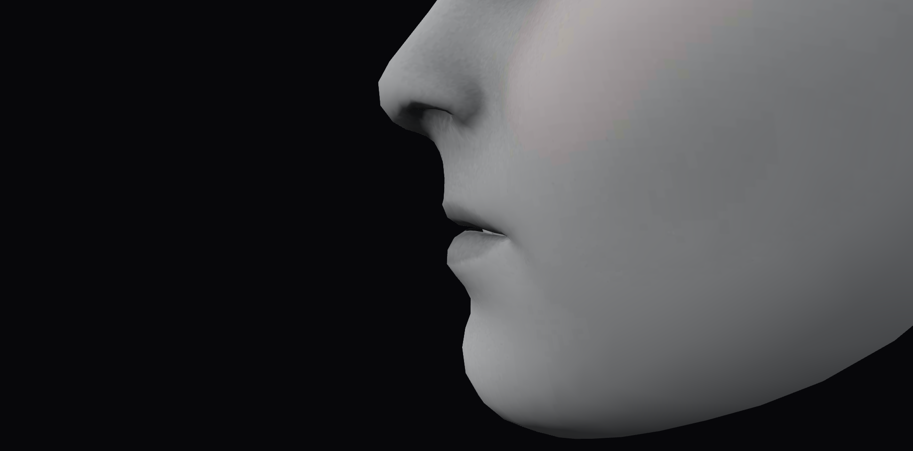
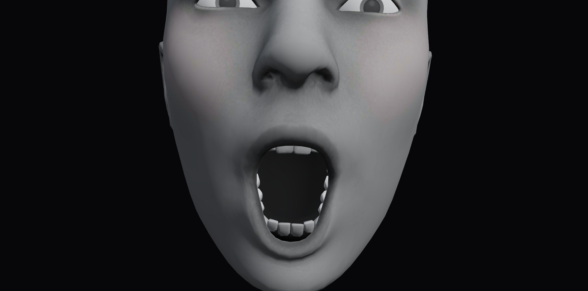
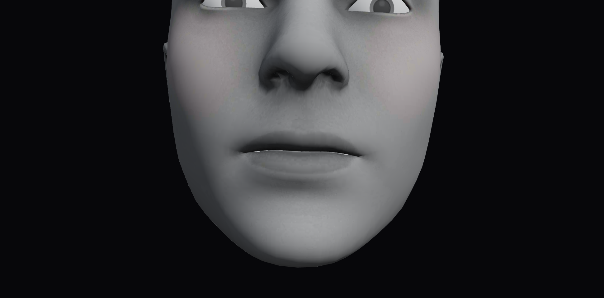

# T weight search on FaceCap

This records the #148 search and its then-current AA comparison (jawOpen 0.9).
Issue #149 subsequently repaired other presets, including AA; see
[the stricter suite and repairs](lip-suite-regression.md). T remains candidate
1130. Archived search data and AA comparison images below retain their original
weights and hashes.

`phoneme-t` now uses real-mesh search candidate **1130**:

| Weight | Value |
| --- | ---: |
| jawOpen | 0.0025 |
| mouthUpperUpLeft / Right | 0.16 each |
| mouthLowerDownLeft / Right | 0.005 each |
| mouthRollUpper | 0.20 |

The front capture shows a narrow strip of the upper incisors with slightly
parted lips. The profile retains a small opening. Jaw activation is 0.28% of
AA's 0.9, so this has a visibly different mouth shape from AA. This appearance
judgment comes from implementation review of the actual material renders, not
from the distance calculation. Publisher acceptance is still pending.







## Measured limits and choice

The search uses the hash-pinned default FaceCap GLB and the shared posed-position
calculation from the lip-gap check. Neutral selection, world-coordinate units,
clipping, exact unsigned triangle distance and 3D intersection calculations are
those from [issue #147](lip-profile.md). The same neutral-defined lateral bands
are used. Values below are authored glTF metres converted to mm, without
viewport scaling or anatomical rescaling. The shared commissures remain outside
the inherited selection; corner values concern the adjacent selected strip.

| Measurement | Neutral | Previous T (#147) | Selected T |
| --- | ---: | ---: | ---: |
| Front minimum gap (mm) | 1.394 | 143.206 | 11.922 |
| Negative-X middle minimum gap (mm) | 1.126 | 134.218 | 10.771 |
| Positive-X middle minimum gap (mm) | 1.126 | 132.543 | 10.680 |
| Corner-adjacent minimum gap (mm) | 1.246 | 127.026 | 9.888 |
| Global minimum gap (mm) | 1.126 | 127.026 | 9.888 |
| Upper-minus-lower forward extent (mm) | 26.576 | 78.649 | 12.412 |
| Selected lip surfaces intersect | No | No | No |
| jawOpen | 0 | 0.28 | 0.0025 |

Every selected front/middle slab has a minimum distance above 2 mm, including
both middle sides, rather than passing at one central landmark. Global
intersection testing compares every selected upper/lower triangle pair, including
pairs across slab boundaries. Forward overhang is 14.163 mm below neutral; the
limit is neutral's existing overhang, not zero overhang. The source face scale
makes these lengths larger than one might infer from an anatomical head; the
images determine whether the opening still looks slight.

## Values tried

The deterministic Cartesian grid contains **5,600 combinations**:

| Parameter | Values |
| --- | --- |
| jawOpen | 0, 0.0025, 0.005, 0.01, 0.02, 0.04, 0.08, 0.12 |
| mouthUpperUp, bilateral | 0, 0.005, 0.01, 0.02, 0.04, 0.08, 0.16, 0.32, 0.64, 1 |
| mouthLowerDown, bilateral | 0, 0.005, 0.01, 0.02, 0.04, 0.08, 0.16, 0.32, 0.64, 1 |
| mouthRollUpper | 0, 0.05, 0.1, 0.2, 0.4, 0.7, 1 |

The script checks that each requested morph resolves through the same alias
resolver used by the provider. Missing shapes and changed source bytes are
errors, not silently ignored controls. It evaluates all combinations, records
all regions for every row, and retains numerical candidates only when no
selected surfaces intersect, each front/middle minimum is at least 0.002 m,
and global forward overhang does not exceed neutral. As a conservative search
bound for slight parting it also requires every front/middle minimum to be at
most 0.012 m. This upper bound is a filter on regional minima, not a guarantee
about the maximum opening at every surface point; rendered assessment remains
necessary. Jaw is capped at 0.12 and at one quarter of AA's activation. The
0.12 cap is the stronger bound for the current AA.

**488 combinations pass the numerical filters.**
[results.json](t-lip-search/results.json) records all 5,600 tuples, actual weights,
global and regional gaps, intersection witnesses, forward extent, rejection
reasons, source hash, neutral baseline and exact region boundaries. Candidate
IDs are zero-based grid order, not ranks.

The geometry shortlist ranks smaller openings first, then lower total
activation, then grid order. The appearance shortlist additionally includes the
smallest and largest feasible opening for each upper-lip activation. Rendering
both lists prevents a distance-only winner from being mistaken for a T. The
best pure geometry result, candidate 77, uses zero jaw, upper/lower bilateral
0.005 and zero roll: its middle gap is 2.100 mm and its overhang is 26.535 mm.
Its front image does not clearly reveal the upper teeth, so it was not selected.



Candidate 3317 also has small gaps (2.429–2.796 mm centrally) but its full upper
roll hides the teeth. Candidates 1230 and 2145 were less convincing tooth-reveal
shapes in the rendered comparison. Candidates 3103 and 3174 reveal teeth, but
use jawOpen 0.02. Candidate 1130 provides a clear thin incisor strip with
jawOpen only 0.0025, more than 2 mm clearance and substantially less overhang
than neutral. It was chosen for that visual balance and negligible jaw opening.

This is the best of the reviewed render shortlist, not a proof of a global
perceptual optimum over continuous weights. It ranks 486th of 488 by the
opening-only geometry order; the numerically smallest opening was deliberately
not treated as automatic appearance acceptance. The complete explicit decision,
weights and comparison IDs are in [selection.json](t-lip-search/selection.json).
The numeric search report keeps `selectedId: null` because it cannot certify
appearance; the separate reviewed selection is the library's source of choice.

## Reproduction and integrity

The original-files manifest is empty. No original attachments were copied or
published. Source SHA-256 is
`6bfce6d0fcbb5839f5102b79733007859fef7c5df6d9eb49e2264542810b5f64`.

Start `npm run dev`, then generate the search and render its shortlist:

```sh
node scripts/tune-t-lips.mjs
node scripts/capture-t-search.mjs
```

The search never writes the pose library. A candidate needs an explicit rendered
appearance decision as well as passing geometry. If none qualifies, report the
closest candidate and its unmet requirements, leaving the existing pose intact.
The fallback orders failed-constraint count, excess overhang, then the same
opening/activation ranking. Grid failure is not proof of impossibility over all
continuous FaceCap weights.

Captures use the application's real mesh/materials, direct settled morph weights
resolved through provider aliases, and a fixed camera framing based on neutral.
The helper renders synchronously to avoid intermediate animation frames and
restores the original influences afterward. It requires the default FaceCap URL.
Images are front and +X profile views; their perspective and lighting differ
from #147's diagnostic orthographic SVG overlays.

`integrity.json` hashes the exact UTF-8 report and selection bytes;
`capture-integrity.json` hashes every PNG and its metadata. No normalization is
applied. The report integrity test checks every grid tuple and required field,
including the final record, and recalculates the filter decisions and shortlist.
A rerun retains an existing reviewed selection only if its source hash, weights
and geometry still match; otherwise it removes the stale selection and requires
new appearance review. Render-byte equality across different GPUs is not
promised; the hashes protect the committed evidence.

The data search and appearance captures were performed as implementation work.
No build, test suite, or separate self-audit was run. Deferred publisher checks:

```sh
node --test scripts/t-lip-search-policy.test.mjs scripts/t-lip-search-integrity.test.mjs
npx playwright test e2e/t-lip-selection.spec.ts e2e/lip-profile.spec.ts
```

The selected-T browser regression measures the library's current weights against
the real mesh and compares them to the reviewed row. The previous profile test
replays its archived explicit T weights to retain #147's historical baseline;
it does not require the new T to match the old T. Existing pose-audit expectations
now include the selected weights and the additional upper-roll morph.
